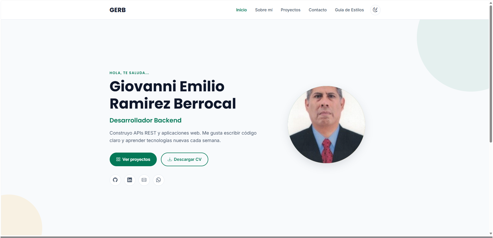

# Portafolio de GERB DEV

Portafolio personal desarrollado con **Angular**: presentación, experiencia, proyectos y contacto.

🔗 **Sitio publicado:** https://gerb-developer.github.io/portafolio/



## Funcionalidades

- 5 páginas con navegación: Inicio, Sobre mí, Proyectos, Contacto y Guia de Estilos
- Efecto de máquina de escribir en la presentación
- Línea de tiempo y barras de habilidades animadas
- Filtro de proyectos por tecnología
- Formulario de contacto con validación
- Modo oscuro que se recuerda entre visitas
- Diseño responsive con menú para celular
- Animaciones al hacer scroll, respetando `prefers-reduced-motion`
- Publicación automática con GitHub Actions

## Tecnologías


## Ejecutar en tu PC

Requisitos: Node.js 24 o superior.

```bash
git clone https://gerb-developer.github.io/portafolio/
cd portafolio
npm install
npx ng serve
```

Abrir http://localhost:4200

## Estructura

```
src/app/
├── data/       Datos del portafolio (perfil, experiencia, proyectos)
├── layout/     Navbar y footer
├── pages/      Inicio, Sobre mí, Proyectos y Contacto
└── shared/     Directiva de animación al hacer scroll
```

## Autor

**Giovanni Ramirez Berrocal**, estudiante de Desarrollo de Sistema de Informacion en el IESTP Argentina.

- LinkedIn: https://www.linkedin.com/in/giovanni-emilio-ramirez-berrocal-28b5161b8/
- Correo: ramirezberrocalgiovanni@gmail.com
